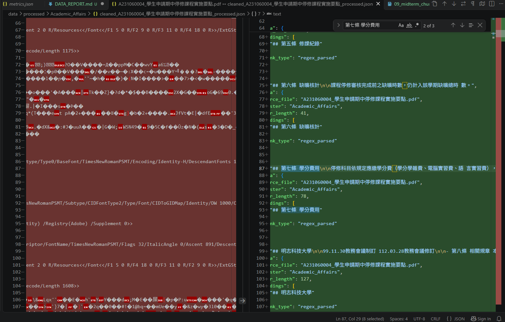
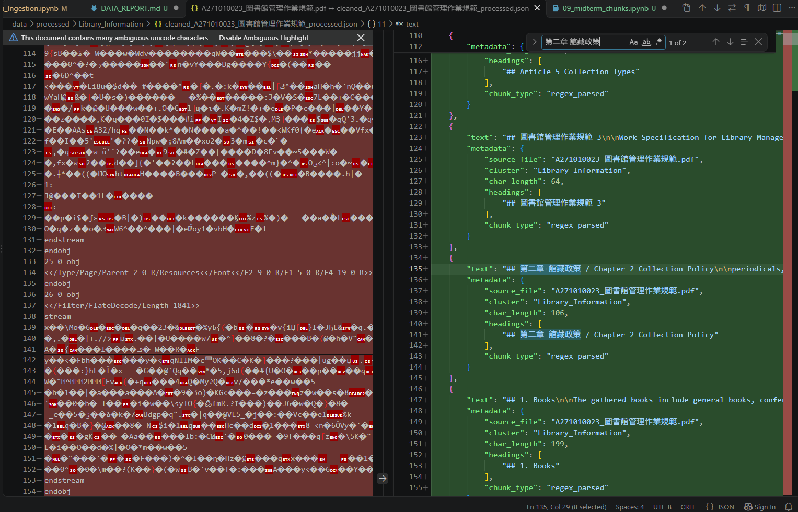
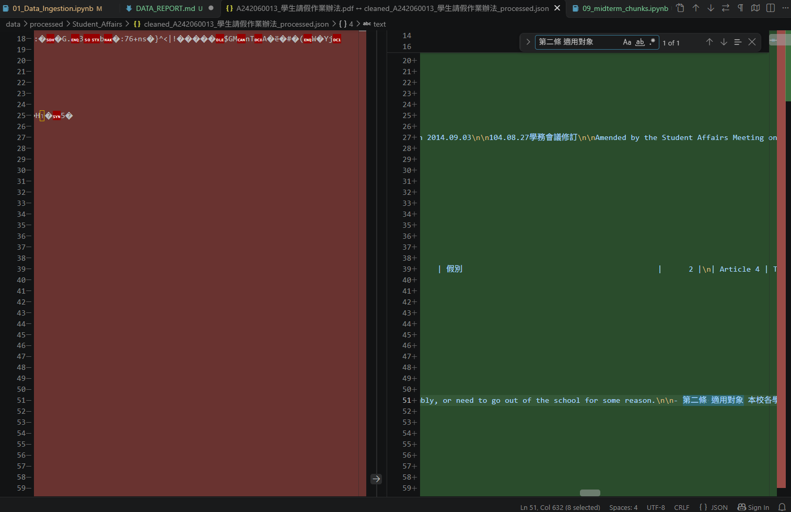
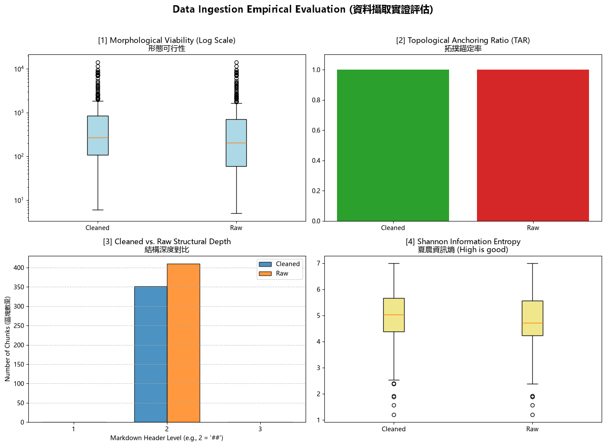

# 資料前處理報告 (Data Preparation Report)

> 期中評量 · NLP 自然語言處理 115-S1
> 填寫方式：請把所有「（ ）」與 `___` 替換成你自己的內容，並刪除 `>` 開頭的說明文字。

- **學號 / 姓名**：U12627035 楊育賓
- **專案名稱**：nlp-mcut-qa-system-main
- **完成的任務**：- [x] 1-A 頁首頁尾清除　- [x] 1-B 雙語標題合併　- [x] 1-C 雙語條文合併

---

## 1. 資料集概覽 (Dataset Overview)

> 數字來源：`01_Data_Ingestion.ipynb` 第 2 節 (掃描 PDF) 與第 5 節 (批次處理) 的輸出。

| 類別 (Cluster) | PDF 數量 | 清洗前 chunk 數 | 清洗後 chunk 數 |
|---|---|---|---|
| Academic_Affairs | 3 | 96 | 67 |
| Library_Information | 3 | 248 | 229 |
| Student_Affairs | 3 | 66 | 55 |
| **合計** | 9 | 410 | 351 |

**問題 (2–3 句)：** 清洗後 chunk 數量變少了多少？是哪個任務造成的？有沒有哪個任務**不影響** chunk 數量？為什麼？
1、59 
2、1-A 移除部分帶 ## 的重複法規名稱，使 chunk 從 410 降至 396，1-B 移除合併後的英文標題標記，使數量再降至 351 
3、1-C 
4、因為1-C處理的是 - Article 清單項目，所以不會影響Chunk的數量

> 提示：chunk 是用什麼規則切開的？請看 notebook 第 5 節的 `chunking_regex`。

## 2. 清洗步驟 (Cleaning Steps)

> **截圖來源：** `data/interim/<類別>/` 中的 `raw_*.md` (清洗前) 與 `cleaned_*.md` (清洗後)，也就是批次處理存下的**真實檔案**。
>
> **[重要] 不可使用 notebook 中的範例。** notebook 任務 1-A、1-B、1-C 的測試文字 (第二十一條、明志科技大學 / Ming Chi University of Technology、第十五條 / Article 15) **不能**作為你的截圖。請在真實檔案中**另找一處**，可以是其他 PDF 的檔案。使用範例的截圖**不給分**。
>
> **截圖方法 (VS Code 比較檢視)：**
> 1. 在檔案總管對 `raw_<檔名>.md` 按右鍵 → **Select for Compare**。
> 2. 對同一份文件的 `cleaned_<檔名>.md` 按右鍵 → **Compare with Selected**。
> 3. 左右並排顯示，紅色 = 刪除，綠色 = 新增或修改。按 `Ctrl + F` 搜尋，找到該任務造成的變更。
> 4. 每個任務截**一張**圖，存到 `reports/figures/`，**檔名必須完全相同** (否則圖片不會顯示)：
>    * 任務 1-A → `1a_compare.png`
>    * 任務 1-B → `1b_compare.png`
>    * 任務 1-C → `1c_compare.png`

### 2.1 任務 1-A：頁首頁尾溢出清除

- 檔名：1a_compare
- 搜尋文字：第七條 學分費用
- 改變了什麼：Raw 第 55、59 行的重複法規名稱被刪除，第 59 行原本帶有 ##，刪除後少了一個切塊邊界，停修後已繳費用不退、未繳費須先補繳的規定仍在 Cleaned 第 51 行
- 對問答檢索的幫助：查詢停修是否退費時，減少重複法規名稱形成的區塊佔據檢索結果的機會
- 有沒有改錯：有，在同一份 Raw 檔案搜尋 A031060004，第 7 行位於規章編號與制定部門之間，是文件開頭的正式法規名稱，也被刪除了



### 2.2 任務 1-B：雙語標題合併

- 檔名：1b_compare
- 搜尋文字：第二章 館藏政策
- 改變了什麼：Raw 第 184、186 行的中英文標題原本各有一個 ##，清洗後合併成第 180 行的 ## 第二章 館藏政策 / Chapter 2 Collection Policy
- 對問答檢索的幫助：搜尋「館藏政策」或 Collection Policy 時，可對應到同一個章節標題，減少找回只有標題的獨立區塊
- 有沒有改錯：有，在 cleaned_A273020009_學生宿舍學術網路使用及管理辦法.md 搜尋 表號：A073020109，第 247 行將表單編號與英文表單名稱 Report of Prevention and Correction 合併成一個標題



### 2.3 任務 1-C：雙語條文合併

- 檔名：1c_compare
- 搜尋文字：第二條 適用對象
- 改變了什麼：Raw 第 115、116 行分開列出中文第二條與 Article 2 Applicability，清洗後移除英文項目前的 -，用 / 把兩者接在第 110 行，英文正文仍保留在第 112 行
- 對問答檢索的幫助：查詢「延修生能不能請假」時，可在同一段找到適用對象與對應的英文條號
- 有沒有改錯：有，在 cleaned_A271010023_圖書館管理作業規範.md 搜尋 Article 27 The Library adheres，第 737 行把英文第二十七條的開頭接到中文第十款末尾，詳見第 4 節



## 3. 評估指標與 AI 解讀查證 (Metrics & Verifying the AI's Interpretation)

### 3.1 指標數據表

> 數字來源：專案根目錄的 `metrics.json`。[1]、[2] 必填；[3]、[4] 選填。
> 「參考值」由老師在課堂上公布 (完成全部任務的結果)。

| 指標 | Raw | Cleaned (你的) | Cleaned (參考值) |
|---|---|---|---|
| [1] 中位數長度 Median Length | 205.0 | 269.0 | 270.5 |
| [2] 拓撲錨定率 TAR | 1.0 | 1.0 | 1.0 |
| [3] 深度變異量 SDV (選填) | 0.0 | 0.0 | 0.0 |
| [4] 中位數資訊熵 Entropy (選填) | 4.719958679606001 | 5.033184175406308 | 5.0623172389748445 |

> **儀表板截圖：** 你自己的 `01_Data_Ingestion.ipynb` **第 6 節**輸出的 4 拼圖儀表板 (第 8 週執行並保留的輸出)。截圖後存為 `reports/figures/dashboard.png`。第 3.2 節也會用到這張截圖。



你的 Cleaned 結果與參考值一致嗎？若一致，寫「一致」；若不一致，找出原因。（1 句）
1.不一致
2.我的中位數長度與資訊熵略低於參考值，可能與清洗後的條文合併或切塊結果不同有關，確切原因仍需比對兩版的清洗輸出。

### 3.2 AI 的解讀

> 把第 3.1 節的儀表板截圖 (`dashboard.png`) 交給 AI，請它解讀結果。將 AI 的回答**完整貼在這裡**，並註明使用的 AI 工具。

- 使用的 AI 工具：codex

```text
左上圖的橘線顯示，Cleaned 的 chunk 長度中位數高於 Raw。縱軸採對數刻度，清洗後仍有超過一萬字元的離群值。右上圖顯示兩組的 TAR 都是 100%，左下圖也顯示所有錨定 chunk 的標題深度都是 2。清洗後，深度 2 的 chunk 數量下降。

右下圖顯示，清洗後字元層級的資訊熵中位數上升，但仍有低熵離群值。較高的熵代表字元分布更分散，可能來自雙語合併，也可能受表格符號、排版與其他內容改變影響。要判斷問答檢索是否改善，還需要用實際問題檢查找回的段落和答案。
```

### 3.3 你的查證 (至少兩點)

> 挑 AI 說得最肯定的兩句話，回到你的檔案或程式中找證據：它說的是真的嗎？

**查證 1**
- AI 的說法：清洗後的長度中位數較高，且仍有超過一萬字元的離群值
- 我查了什麼 (哪個檔案、哪個 chunk、哪段程式)：分別讀取 9 份 Raw 和 9 份 Cleaned JSON，按 text 的字元數重算中位數，再查看 cleaned_A271010023_圖書館管理作業規範_processed.json 中索引 108 的 chunk。
- 結論：正確 ，因為 中位數由 205 增至 269 字元，而索引 108 的 ## 1. Reader Account Login 清洗後仍長達 11,497 字元。

**查證 2**
- AI 的說法：兩組的 TAR 都是 100%，而且標題深度都是 2
- 我查了什麼：依 01_Data_Ingestion.ipynb 第 6 節的 get_tar 與 get_depths，逐筆檢查 JSON 的 text 是否以 # 開頭，並計算開頭連續 # 的數量。
- 結論：正確 ，因為 Raw 410 筆和 Cleaned 351 筆均以 ## 開頭，因此 TAR 都是 100%，SDV 都是 0。第 4 節的誤併同樣出現在有標題的 chunk 中，顯示 TAR 只檢查標題標記。

### 3.4 實際證據：你被指定的 chunk

> 執行 `09_midterm_chunks.ipynb`：填入你的學號與老師在課堂上公布的 SEED，按 Run All。
> 每位同學拿到的 chunk 不同。請**連同驗證碼**一起填入。
> 程式只顯示前 400 字元的預覽。請在 VS Code 打開程式列出的**閱讀用檔案** (`data/interim/` 中的 `cleaned_*.md`，與 JSON 內容相同但有正常換行)，按 `Ctrl + G` 輸入程式給的**行號** (或按 `Ctrl + F` 搜尋「搜尋用」文字)，從該行讀到下一個 `## ` 標題為止，就是**完整**的 chunk。

- **SEED**：1106

**(a) 很長的 chunk**
- 資料檔 (JSON)：cleaned_A271010023_圖書館管理作業規範_processed.json　位置：第 108 個 (從 0 開始數)　長度：11497 字元　驗證碼：a5e5240a
- 閱讀用檔案 (`.md`)：cleaned_A271010023_圖書館管理作業規範.md　從第 1187 行開始
- 前 3 行內容：
  ```text
## 1. Reader Account Login

- (1) Faculty members and students who are subject to the school-leaving procedure may use their identification cards issued by this School as library passes. Those who do not have the identification cards issued by this School shall use their own identity cards as library passes. Families of faculty and staff may borrow books by using the employee's identification card issued by this School and the family member's own identity card.

  ```
- 這是什麼樣的文字？為什麼會這麼長？這段英文規章從讀者帳號登入開始，接著涵蓋證件效期、借還書程序、預約、續借、借閱額度、逾期罰款與賠償。
- 之後做問答檢索時，這麼長的 chunk 可能造成什麼問題？後續小節以普通編號開頭，切塊規則只在 ## 前切開，於是多個主題留在同一個 chunk。查詢「逾期一天罰多少」時，其他主題可能降低這個 chunk 的檢索相關性。如果系統截斷過長的文字，後面的罰款條文也可能遺失。

**(b) 資訊熵很低的 chunk**
- 資料檔 (JSON)：cleaned_A271010023_圖書館管理作業規範_processed.json　位置：第 163 個 (從 0 開始數)　資訊熵：2.99　驗證碼：349712e6
- 閱讀用檔案 (`.md`)：cleaned_A271010023_圖書館管理作業規範.md　從第 1826 行開始
- 內容：
  ```text
## 明志科技大學圖書館 非專任教職人員借閱服務申請單

| 讀             | 填表日期             | 西元 年   | 月 日                             | 姓名                              |
|----------------|----------------------|-----------|-----------------------------------|-----------------------------------|
| 者 資          | 身分證字號/ 護照號碼 |           |                                   | 聯絡 電話                         |
|                | E-mail               | 料        | 料                                | 料                                |
| 讀 者 在 校 身 | □校友                | 學號      |                                   |                                   |
|                | □校友                | 學制      | ○四技 ○研究所 ○二技 ○專科 ○其他： | ○四技 ○研究所 ○二技 ○專科 ○其他： |
|                | □校友                | 畢業系所  |                                   |                                   |
| 分             | □退休教職員          | 服務單位  |                                   |                                   |

| 圖書館收件   | 西元   | 年   | 月 日   | 收件經辦            |
|--------------|--------|------|---------|---------------------|
| 有效期間     | 西元   |      | 年 月   | 日 至 西元 年 月 日 |
  ```
- 為什麼它的資訊熵這麼低？它對問答檢索有用嗎？這是一張空白借閱服務申請單。表格用大量空白、連字號及直線對齊，且身分別和校內相關單位的選項在相鄰欄位重複出現，使字元分布集中。這個 chunk 可以回答「申請單需要填哪些欄位」或「需要誰簽章」。若要回答完整的申請資格或借閱期限，還要查對應的規章正文。

## 4. 一個尚未解決的問題 (One Remaining Problem)

> 打開 `data/interim/` 中任一個 `cleaned_*.md` (與 `data/processed/` 的 JSON 內容相同，但有正常換行，比較好讀)，找出一個清洗後**仍然有問題**的 chunk。
> 每個 chunk 從一個 `## ` 標題開始，到下一個 `## ` 標題之前結束。
> 例如：只有標題沒有內文、表格亂掉、中英文沒有對齊、還有殘留的頁首頁尾、斷行造成的多餘空白，或是**清洗造成的錯誤** (誤合併、誤刪除)。
> **不可**使用第 3.4 節的兩個 chunk。

- **檔名** (`cleaned_*.md`)：cleaned_A271010023_圖書館管理作業規範.md　**從第  723 行開始** (VS Code 左側的行號)　**標題**：## 第八章 受贈資料處理 / Chapter 8 Disposition of Donated Materials
- **我是怎麼找到的** (例如：搜尋了什麼、看了哪個檔案)：在 Cleaned 搜尋 Article 27 The Library adheres，再與同一份 Raw 檔案的條文順序比對
- **問題 chunk (貼上部分內容)**：

```text
- 八、 視聽資料無公播版授權者。
- 九、 無排架號之現期期刊。
- 十、 受贈資料若難以取捨或有爭議時，由本館相關各組會商決定 之。 / Article 27 The Library adheres to the principle of accepting all types of materials that comply with the collection development policy. Any cases falling under the following circumstances should be politely refused:
1. Piracy or violation of the Copyright Act.
```

- **問題是什麼**：英文第二十七條的開頭接到中文第十款末尾，看起來像是第十款的翻譯。實際上，英文開頭對應的是中文第二十七條的條首。
- **可能的原因** (PDF 本身？Docling 轉換？清洗的正則表示式？切塊規則？)：Raw 先列完中文條文的各款，再開始英文條文。1-C 的規則只檢查 - Article 27 前一行是否含中文字，沒有核對前一行是不是中文條首，也沒有比對中英文條號。
- **具體的修正方法** (例如：一條規則、一個正則表示式的構想、長度上限)：只在中文行以「第…條」起頭，且中文條號轉成數字後與英文條號相符時，才允許行級合併。條首隔著多款時，保留原段落，待能依條號配對完整條文後再合併。
- **對問答檢索的影響**：詢問「受贈資料有爭議時由誰決定」時，模型可能把接在後方的英文拒收原則誤用為第十款的翻譯或答案。

## 5. AI 協作 (AI Collaboration)

- 本次作業的 AI 協作紀錄請見 [`AI_USAGE.md`](AI_USAGE.md) 的「Week 04 / 08」與「Week 09」段落。
- 這次使用 AI 最大的收穫或教訓是 把 AI 的圖表解讀拆成可以查證的說法。用 JSON 確認兩組 TAR 都是 100% 後，再回到條文檔案檢查，才找到有標題卻配錯中英文條文的例子。（請具體：例如提示詞中哪一段最關鍵、AI 哪一句解讀不正確）
